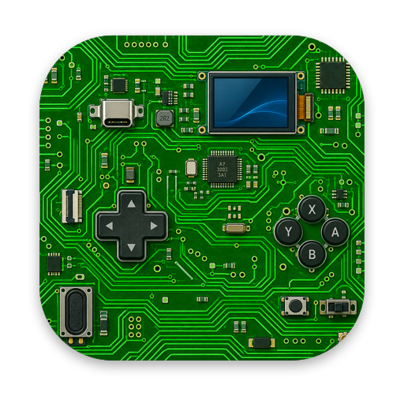
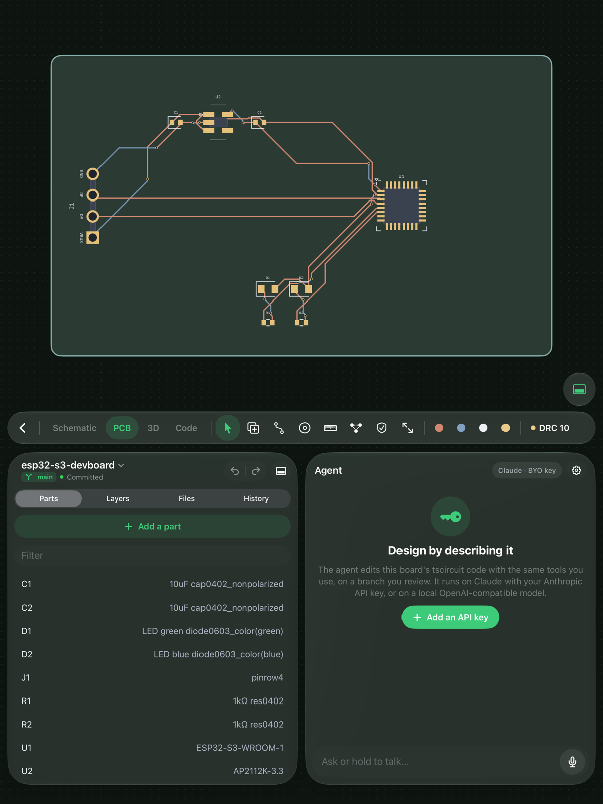
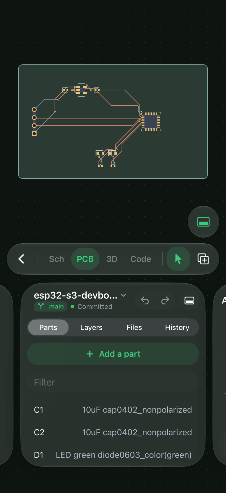
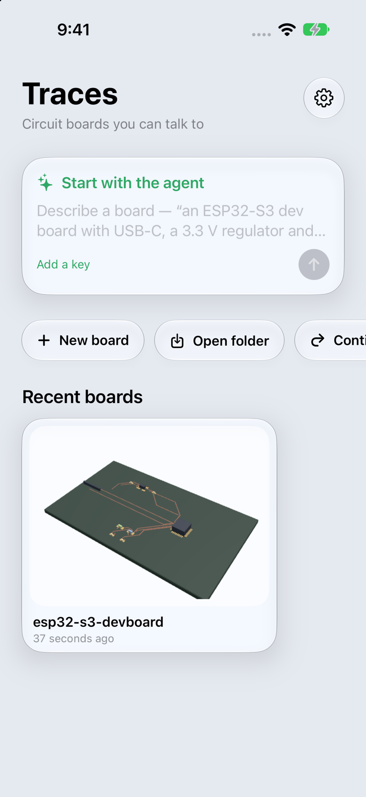

<p align="center"></p>

# Traces

Circuit boards you can talk to. A native SwiftUI app for iPhone, iPad and Mac (iOS/macOS 26) for designing
circuit boards as [tscircuit](https://tscircuit.com) code, with a built-in agent. Traces is an independent app
built on the open-source tscircuit packages and not an official tscircuit product.

<p>
  
  
  
</p>

- Describe a board and the agent writes the tscircuit code, places parts, routes and runs DRC on a branch you review
- Live schematic, PCB, 3D and code views; drag, rotate, place vias and route by touch
- Real parts from JLCPCB and DigiKey with their symbols and footprints
- Gerber, drill, BOM and pick-and-place export; every project is a plain folder with its own git history
- Claude (your Anthropic API key) or any local OpenAI-compatible model; MCP server on the Mac

## Install

- **Mac**: download `Traces.dmg` from the [website](https://syousif94.github.io/traces/) or the
  [latest release](https://github.com/syousif94/traces/releases/latest). Signed and notarized; macOS 26, Apple silicon.
- **iPhone / iPad**: the repo has a [`selfstore.yml`](selfstore.yml), so you can add `syousif94/traces` to
  [SelfStore](https://github.com/syousif94/SelfStore) and install `selfstore/Traces-iOS.ipa` over the air. iOS 26 or later.

## Layout

| Path | What |
|---|---|
| `engine/` | Bun bundle of the real tscircuit packages (`tscircuit`, `@tscircuit/eval`, `@tscircuit/checks`, Gerber/BOM/PnP converters) → `app/Shared/Resources/engine.js`, run in a hidden WKWebView. Jobs: `compile`, `drc`, `export`. |
| `crates/traceworks-core/` | Rust core (UniFFI → `TraceworksCore.xcframework`): agent loop, 16-tool registry, Anthropic + OpenAI-compatible providers, search/replace diff applier, git (libgit2), agent branches, placement writer, MCP request handler. |
| `crates/traceworks-mcp/` | Standalone stdio ↔ unix-socket relay (the Mac app also does this itself with `--mcp`). |
| `app/Shared/` | SwiftUI app: native PCB / schematic / 3D renderers, code editor with diff review, agent panel, parts library, and one Nurby-style studio layout for Mac, iPad and iPhone (`Layouts/StudioWorkspace.swift`). |
| `templates/esp32-s3-devboard/` | Starter project (plain tsci folder). |

## Build

Requires Xcode 27+, Rust (targets `aarch64-apple-ios`, `aarch64-apple-ios-sim`, `aarch64-apple-darwin`), Bun, and XcodeGen.

```sh
make engine   # tscircuit bundle
make core     # Rust XCFramework + Swift bindings
make mac ios  # generate the Xcode project and build both apps
make test     # Rust tests + engine smoke compile
```

Or open `app/Traces.xcodeproj` after `make project` and run `Traces-Mac` / `Traces-iOS`.

Launch arguments for testing: `-newFromTemplate` (creates and opens a project from the template), `-openFirst`, `-open <folder>`.

## How it works

- **Projects** are plain folders the `tsci` CLI can open; each is a git repo (`main`). Mac library: `~/Documents/Traces` (moved from `~/Documents/Traceworks` on first launch); iOS: the app's Documents folder (visible in Files). "Open Folder…" adds folders from anywhere.
- **Compile** runs 300 ms after the last edit; DRC runs after each compile. Export writes `<project>-<short commit>.zip` (Gerbers, drill, BOM, pick-and-place) and is blocked while DRC has errors.
- **Agent** turns run in Rust. Writes land on an `agent/<slug>` branch shown as a diff; *Accept & commit* three-way-merges onto `main`, *Discard* deletes the branch. Max 40 tool calls per turn; the harness requires `compile` after edits and `run_drc` after placement/routing changes. The Anthropic key lives in the Keychain. Claude requests opt in to server-side fallbacks (`anthropic-beta: server-side-fallback-2026-07-01`).
- **Layout** follows Nurby: the live view full-bleed and one glass bar at the bottom (back, the Schematic / PCB / 3D / Code switcher, the view's tools, PCB layer toggles, DRC, in groups, scrolling sideways when it doesn't fit, with the panels button in its own circle beside it (above it when space is tight); hold a finger on it and slide to read each control's name, lift to use it; drag it up or down to resize or hide the panels), and a right sidebar (drawer: parts, layers, files, history; agent below). Taller-than-wide windows dock the two panels along the bottom; narrow ones page them sideways with a Selected page. All four views stay loaded and cross-fade when you switch; the 2D views fit the board into the area the bar and panels leave open, and keep refitting until you pan or zoom (then they only recentre). The start page shows a 3D picture of each board (`Thumbnails`, SceneKit, redrawn after compiles; boards never opened are compiled once in the background).
- **Real parts** (Add a part): JLCPCB search via tscircuit's jlcsearch index; choosing one fetches its EasyEDA symbol/footprint natively and converts it in the engine (`easyeda` job, tscircuit's own converter, as `tsci import` does) into `imports/<Part>.tsx` with pin labels and `supplierPartNumbers.jlcpcb`. DigiKey search uses the Product Information v4 API with your client ID/secret (Settings, Keychain); a DigiKey part takes the footprint of the same MPN at JLCPCB (and gets both part numbers), else a footprinter string for common passives/packages.
- **Touch edits** (drag, number input with expressions and `vars.ts` variables, rotate, place part/via, route) rewrite source literals, or `manual-edits.json` where there are none; they auto-commit after 10 s idle. Undo/redo cover touch edits.
- **MCP** (Mac, Settings → MCP): `claude mcp add traces -- /Applications/Traces.app/Contents/MacOS/Traces --mcp` exposes the same tools for the open project. The app binary relays stdio to the app's socket, so the bundle has a single executable to sign. (`crates/traceworks-mcp` is the same relay as a standalone binary.)

## Release

`scripts/deploy.sh ["notes"]` builds everything through [SelfStore](https://github.com/syousif94/SelfStore) running on
this Mac (`http://localhost:8765`):

1. builds the engine bundle and Rust core if they're missing (`FULL=1` rebuilds them) and regenerates the Xcode project;
2. builds `Traces-iOS`, exports it to `selfstore/Traces-iOS.ipa` + `selfstore.yml` and commits them (it's also
   installable from that SelfStore right away);
3. builds `Traces-Mac`, signed with Developer ID and notarized, and releases `Traces.dmg` / `Traces.zip` on GitHub;
4. writes `docs/latest.json` (the website's download link), pushes, and turns on GitHub Pages for `docs/`.

`SKIP_IOS=1`, `SKIP_MAC=1`, `SITE_ONLY=1` (just push `docs/`), `DRY_RUN=1` and `DRAFT=1` narrow it down.
Icons come from `design/icon-source.png`: `swift scripts/make-icons.swift` regenerates the iOS and Mac app icons and
the website's icon. The bundle ID stays `com.sammy.traceworks` (the app's earlier name) so installs, boards and
Keychain items carry over; Rust crates and the XCFramework keep the `traceworks` name too.

## Not done yet

Apple Foundation Models provider; USDZ/PDF export and GLB 3D models; tree-sitter highlighting; Metal renderer (2D uses Core Graphics via `Canvas`); `autoroute` ignores its `nets` argument; cancel marks results stale rather than interrupting the engine; the code editor's undo is separate from the board undo stack.

## Credits

Agent reference docs in `crates/traceworks-core/prompt/tscircuit-reference.md` come from [tscircuit/skill](https://github.com/tscircuit/skill) (MIT, see `tscircuit-skill-LICENSE`).
